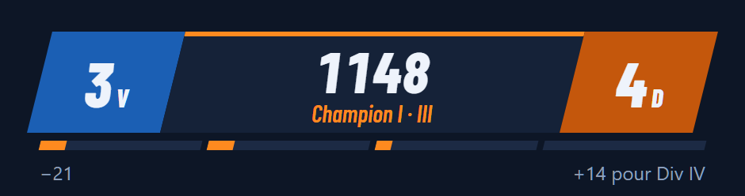

# Rocket League rank overlay

Petite fenêtre toujours au premier plan qui affiche ton **rang, ta division, ton MMR** et tes **victoires/défaites de session** en 2v2 classé (1v1 et 3v3 au menu), sans toucher au processus du jeu.



Victoires en bleu, défaites en orange, MMR et rang au centre. La barre est découpée en 4 segments, un par division, avec la distance pour descendre (à gauche) et pour monter (à droite).

> L'image est le rendu réel de l'interface avec de vrais relevés, générée par `npm run screenshot` : ce n'est pas une capture d'écran du jeu.

## Comment ça marche

Rocket League écrit dans `Documents\My Games\Rocket League\TAGame\Logs\Launch.log`, à chaque entrée en file, ton MMR interne, ton tier et la playlist. L'appli lit ce fichier en **lecture seule** (un `stat` toutes les 2 secondes, lecture incrémentale) :

- `MMR = mu × 20 + 100` (formule communautaire, cohérente avec les tiers lus dans le journal)
- le **tier** vient du journal et fait foi ; la **division** est déduite du MMR avec une table de seuils 2v2 ;
- victoires et défaites se déduisent de la variation de MMR entre deux files (les gains réels, pas un +9 fixe) ;
- les seuils réels de montée et de descente de tier sont **appris** à chaque changement de tier observé (le jeu applique une hystérésis : on monte à un seuil plus haut que celui où l'on redescend).

Aucune injection, aucune lecture de mémoire, aucun réseau : l'appli ne fait que lire un fichier texte que le jeu écrit déjà.

## Limites connues

- Le journal ne donne le MMR **qu'à l'entrée en file** : juste après un match, l'affichage garde l'ancien MMR et indique « 1 match en attente ».
- Les seuils de division de `core/ranks.js` viennent de la distribution Tracker Network (plages observées, pas des seuils officiels). Les valeurs approximatives sont précédées de « ≈ ».
- En groupe (duo), le journal donne le MMR du chef de groupe : ces relevés sont ignorés pour les victoires/défaites.
- Testé sur un compte Epic, Windows. Compatibilité avec Steam probable mais non vérifiée.
- Non testé pendant une partie classée avec Easy Anti-Cheat actif. L'appli ne touche pas au jeu, mais je ne peux pas le garantir à la place de Psyonix.
- Pas de lien avec Psyonix ni Epic Games. « Rocket League » est une marque de Psyonix.

## Installation

Node.js 20 ou plus.

```bash
npm install
npm start
```

- Glisser avec le bouton gauche pour déplacer la fenêtre.
- Clic droit : choix de la playlist (1v1, 2v2, 3v3) et quitter.
- `RL_LOG_DIR` permet de pointer vers un autre dossier de journaux.

L'historique des relevés et la position de la fenêtre sont enregistrés dans le dossier de données de l'application (`%APPDATA%\rocket-league-rank-overlay`).

## Architecture

```
core/            logique pure, sans dépendance, entièrement testée
  ranks.js         table des rangs 2v2 et localisation d'un MMR
  logparser.js     extraction des relevés depuis les lignes du journal
  calibration.js   apprentissage des seuils de montée/descente (hystérésis)
  view.js          historique -> modèle d'affichage (session, segments, distances)
src/main/        Electron : fenêtre, suivi du journal, stockage
  main.js          fenêtre transparente sans focus, menu, déplacement
  logWatcher.js    tail incrémental de Launch.log, reprise après relance du jeu
  store.js         historique JSON dédoublonné + réglages
  paths.js         localisation du dossier de journaux
src/preload/     pont minimal et sûr vers l'interface (contextIsolation)
src/renderer/    interface : HTML/CSS/JS sans framework, polices locales (OFL)
test/            tests node:test sur données synthétiques
scripts/         outils de diagnostic sur de vrais journaux (npm run scan)
```

`core/` ne dépend ni d'Electron ni du système de fichiers : on peut le réutiliser tel quel avec une autre interface.

## Performances

Mesuré sur la version actuelle : 3 processus, environ 86 Mo de mémoire privée, environ 0,1 % d'un cœur au repos. L'accélération matérielle est désactivée (l'appli n'affiche que du texte et quelques barres) et rien ne tourne en boucle à part le `stat` toutes les 2 secondes.

## Tests

```bash
npm test
```

## Licence

MIT. Police Barlow Condensed sous licence SIL OFL 1.1 (`src/renderer/fonts/LICENSE-OFL.txt`).
